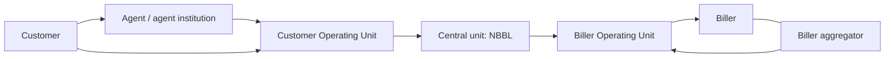

# 1. The ecosystem: who is who

BBPS is an integrated bill payment platform that works over multiple channels and payment modes. The RBI Directions say a bill must be fetched before payment is initiated; for prepaid services, the customer-biller relationship is validated through the platform. NBBL's own site describes the network as "not a payment gateway" and "not a payment aggregator".

| Player | What it does | Source |
|---|---|---|
| **Central unit (BBPCU)** | Operates BBPS, sets operational, technical and business standards, and undertakes clearing and settlement. NPCI Bharat BillPay Limited (NBBL) is the authorised central unit. It approves biller onboarding and issues each biller a unique ID | RBI Directions 2024, para 4(b), 5(a); bharat-connect.com |
| **BBPOU** | A participant in BBPS. May be a Biller Operating Unit, a Customer Operating Unit, or both | RBI Directions 2024, para 4(c) |
| **Biller Operating Unit (BOU)** | Onboards billers onto BBPS for bill collection, directly or through biller aggregators; also carries out settlement of funds on behalf of billers | RBI para 4(c)(1); bharat-connect.com |
| **Customer Operating Unit (COU)** | Gives customers a physical or digital interface to pay bills, directly or through agent institutions | RBI para 4(c)(2) |
| **Agent institution** | An entity certified by NBBL that provides the customer interface (physical or digital) for bill payments. The COU is responsible for its agent institutions' activities | RBI para 4(a), 6(c)(4) |
| **Agent** | A customer touchpoint such as a branch, collection centre, business correspondent or outlet | bharat-connect.com |
| **Biller aggregator** | Aggregates billers so they can connect to a BOU | RBI para 4(g) |
| **Biller** | The service provider that collects payments; connected to BBPS through a BOU, directly or via an aggregator | RBI para 4(f) |
| **Technology service provider (TSP)** | Certified by NBBL. No funds in the system may flow through a TSP | RBI para 4(i), 6(a)(5) |
| **Sponsor bank** | A scheduled commercial bank that settles with NBBL on behalf of non-bank BBPOUs | RBI para 4(h) |

Who can be an operating unit: banks (scheduled commercial banks including RRBs, UCBs, StCBs, DCCBs), non-bank payment aggregators authorised under the PSS Act, and other existing authorised entities. Banks and non-bank payment aggregators need no separate authorisation but must intimate the RBI's Department of Payment and Settlement Systems before starting (para 5(b)).

NBBL's site describes the platform flow the same way: the customer's request goes to the central unit, then to the relevant operating unit, then to the biller, which updates the account and sends confirmation.

## Scale, as NBBL describes it
NBBL's website says "10+ payment modes", "700+ digital channels" and "5 lakh+ physical outlets" (marketing figures, not audited statistics). UPI is one of the payment modes.

## Not defined in the official sources I could read
The terms "online biller" and "offline biller" are widely used in the industry for billers whose bills are served live versus from periodically supplied data. The RBI Directions and the public NBBL pages I could read do not define them, so treat that distinction as industry usage, not scheme terminology.
