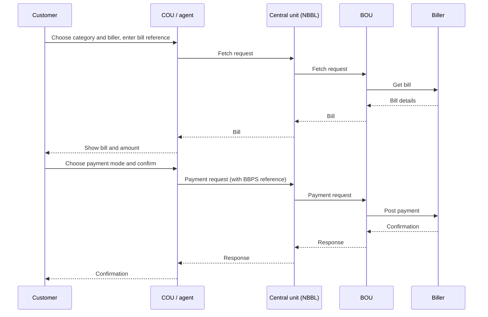

# 2. Bill fetch and bill pay

## What the official sources say
- **A bill must be fetched before payment is initiated.** For prepaid services, the customer-biller relationship is validated through the platform instead (RBI Directions 2024, para 4(d)).
- **Every transaction carries a BBPS reference number from the payment initiation stage** (para 6(a)(4)). The same number is used to raise and resolve disputes (para 8(ii)).
- **No funds in the system may flow through a technology service provider** (para 6(a)(5)).
- **Customer view** (from NBBL's website): in a partner bank app or at an outlet, choose Bill Payment; enter the biller category, biller name and bill reference number; review the bill, enter the amount and choose a payment method; confirm.
- **Platform view** (NBBL's website): the request goes to the central unit, then to the relevant operating unit, then to the biller, which updates the account and sends confirmation.

## Illustrative sequence
This diagram is a simplified illustration of the flow above. The message names and ordering are mine, not copied from NBBL's technical specification (which I could not read; see [SOURCES](../SOURCES.md)).

## Design points that follow from the rules
- **Fetch first.** Because a bill is fetched before payment, the app can show the due amount and any amount rule before the customer commits.
- **One reference end to end.** Show the BBPS reference on the receipt so a customer can quote it in a complaint.
- **Unknown outcomes.** A payment can time out after the customer has paid. The Directions require failed transactions to follow the harmonised turnaround-time and compensation circular (para 8(iii)), so design a "pending" state and a status check rather than showing a hard failure.
- **Complaints.** All operating units integrate with NBBL's central dispute system (para 8(ii)); a COU must provide a system for raising disputes (para 6(c)(3)).

## Practitioner notes (not from official documents)
These come from general product experience, not from a published rule:
- Wrong or ambiguous customer parameters are a common cause of failed fetches, so show a format hint for the bill reference.
- Billers differ in whether they accept partial, advance or exact amounts. Honour whatever rule the fetched bill carries.

## Billers supported
NBBL's site lists categories under these groups: Housing and Utilities (such as electricity, LPG, water, municipal taxes, housing society maintenance, piped gas, rent, prepaid meter), Communication (landline postpaid, mobile prepaid and postpaid), Travel (such as FASTag, NCMC, eChallan, EV recharge), Finance (such as loan repayment, credit card payments, insurance, education fees, donation, NPS), Entertainment (broadband postpaid, cable TV, DTH, subscriptions) and Leisure (clubs and associations). The page heading says "25+ categories". The list changes as categories are added, so check the live site.
