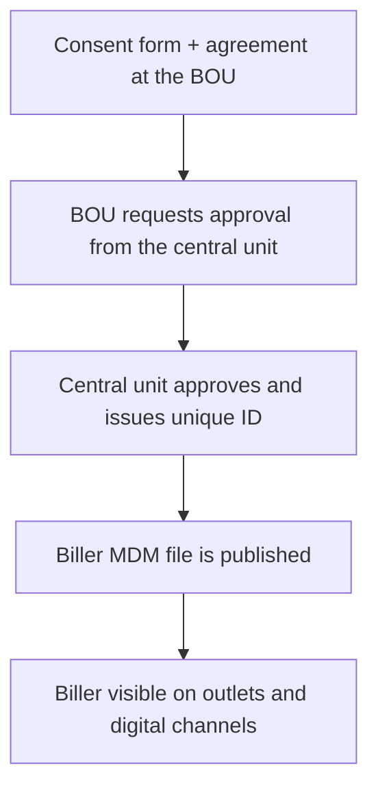

# 3. Biller onboarding

A biller joins BBPS through a Biller Operating Unit. The central unit approves it and issues the biller's unique ID.

## Official steps (NBBL's operating-units page)
1. The BOU collects the duly filled **Biller Consent Form**.
2. The BOU signs an **agreement** with the biller.
3. The BOU sends a **formal approval request** to the central unit on the biller's behalf.
4. After approval, the central unit issues a **unique biller ID**.
5. The biller's profile goes live on physical outlets and digital channels.

## Rules and timelines stated on NBBL's biller FAQ
| Item | Stated rule |
|---|---|
| Consent letter | Must reach the BOU, and the BOU must submit it, within 7 days of receipt |
| Activation | To be completed within 60 calendar days; delays are reported to the central unit and the biller |
| Beyond 60 days | The central unit decides case by case whether to keep or disallow the BOU |
| MDM refresh and front-end rendering | 14 days for existing categories, 60 days for new categories |
| Display | COUs and agent institutions must show all onboarded billers; selective rendering is a violation |
| Delisting | The BOU notifies the central unit within 30 days |
| Changing the default BOU | 60 days' notice |

The central unit publishes the **Biller MDM** (master data) file, which operating units use to render billers.

## Due diligence required of the BOU (RBI Directions 2024, para 6(b))
- Follow the merchant due-diligence rules in the RBI's payment aggregator and payment gateway guidelines of 17 March 2020, as updated.
- Meet any extra due diligence NBBL prescribes for specific biller categories.
- Perform due diligence on billers onboarded through biller aggregators.

## Testing tools named by NBBL
- **BOAT**: described as an API-based portal for testing and onboarding billers.
- **CertPlay**: described as an automated certification portal for operating units.
I could not read their documentation.

## Practitioner notes (not from official documents)
These are observations from practice, not published rules:
- Treat "approved in the scheme" and "enabled in the operating unit's own system" as separate states with separate checks. A biller can be visible and still fail to fetch or pay if only one is done.
- Check that parameter formats in the profile match the real bill data (leading zeros, header spelling, duplicate keys) before go-live.
- Test with the same data shape production will use.
